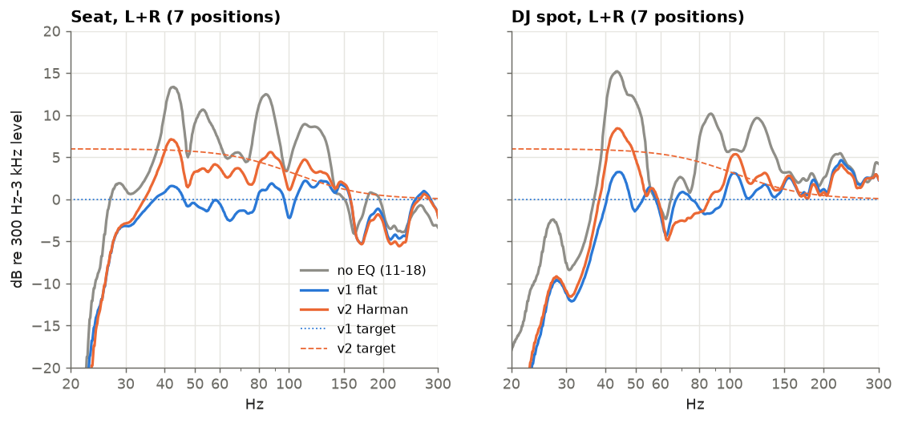
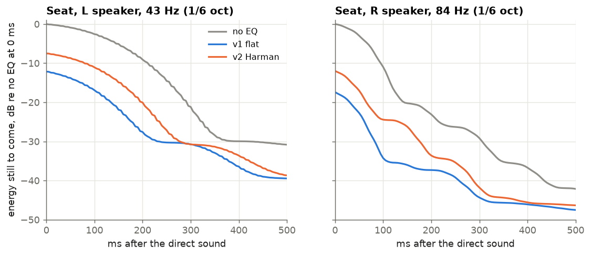

# Taming living-room bass with a small DSP and some Python

A 6.0 × 3.9 × 2.8 m living room, a pair of 2-way floorstanders, a DJ corner and neighbours upstairs. The goal: even bass at the sofa and less bass leaking into the building, using measurements and per-channel EQ on a cheap 4×4 DSP. No bass traps (no space).

Result, both speakers playing, 7 mic positions around the seat, measured:

- Room-mode peaks of +11…+18 dB cut to mostly within ±3 dB of the target. Bass level at the seat (30–150 Hz vs mids): +6.9 dB → −0.1 dB (v1) / +3.0 dB (v2).
- Bass energy in the floor corners (a proxy for what leaks into the building): −7 dB (v1) / −4 dB (v2).
- The worst mode (43 Hz) is 14 dB quieter 100 ms after the direct sound (v1).
- The measured result matches the simulation from the "before" impulse responses within 1.5 dB rms, about as much as re-placing the mic changes it.

This page is the summary. Every number links to the finding, script and raw data behind it.

## Contents

1. [Room and gear](#1-room-and-gear)
2. [How it was measured](#2-how-it-was-measured)
3. [Before: what the room does](#3-before-what-the-room-does)
4. [EQ design](#4-eq-design)
5. [After: measured in the room](#5-after-measured-in-the-room)
6. [Adding a subwoofer](#6-adding-a-subwoofer)
7. [Checking the tools](#7-checking-the-tools)
8. [Open ends](#8-open-ends)
9. [Glossary](#glossary) · [Reproduce](#reproduce)

## 1. Room and gear


*Sketch, not to scale. The speakers fire across the 3.9 m width toward the sofa. Sub positions A/B/C were candidates for the Sub8 (section 6).*

- **Room:** 6.0 × 3.9 × 2.8 m, parquet floor (probably on concrete), sofa against the back wall, molton on the walls (absorbs treble only).
- **Speakers:** Bonsai Akustik Ideal SE, 2-way bass reflex (Seas 17 cm woofer), port tuned to ~35 Hz (measured). Front baffles 0.33 m from the wall. R is 0.43 m from the side wall, L is roughly in the middle of the 6 m wall.
- **Seat:** ~4.4 m along the speaker wall, head ~2.75 m from it, sitting upright at the front of the sofa.
- **DJ spot:** turntables on a cupboard left of L, ~0.75 m from the speaker wall.
- **Chain:** TV / DJ mixer → **t.racks DSP 4x4 Mini** (7 PEQ bands + HPF/LPF per output, 48 kHz) → SMSL A300 class-D amp. Every source goes through the DSP.
- **DSP software:** the vendor editor is Windows-only, so the DSP is configured with a home-made WebHID reimplementation (*tracks*, a separate project) built from the reverse-engineered protocol. The EQ is designed by this repo's scripts and imported as filter text files.
- **Measuring:** Behringer UMC404HD, Omnitronic MM-1C (calibrated), REW at first, then a [Python sweep script](tools/README.md).

More: [docs/context.md](docs/context.md) (room, gear, predicted problems), [docs/current-setup.md](docs/current-setup.md) (wiring and presets now).

## 2. How it was measured

- **Log sweeps with loopback timing:** interface Out 3 → In 2 as the t=0 reference, so every IR shares one time reference. That lets L and R be summed as complex spectra (the "L+R" curves) and the sub be aligned to the mains in software.
- **Spatial average instead of one point:** seat + 6 positions (±30 cm left/right, ±20 cm forward/back, ±10 cm up/down), power average. Same at the DJ spot. Plus the two reachable floor corners as a leakage proxy.
- **Mic placement by delay, not by eye:** the arrival delay of L and R vs the loopback puts the mic back at the seat within 1.4 cm on a later day ([checklist](docs/procedures/session-checklist.md)).
- **Processing:** 500 ms right window, 90° mic calibration, fractional-octave power smoothing. Levels are relative to each curve's own 300 Hz–3 kHz mean (the EQ doesn't touch it), so curves from different days compare directly.
- **v1 and v2 interleaved:** at each mic spot both presets were recalled and swept back to back with the mic untouched, so their difference is exact.

Data: [measurements/](measurements/README.md) (REW projects + IR WAVs per set). Analysis method: [analysis/README.md](analysis/README.md).

## 3. Before: what the room does


- **Every big peak is a room mode.** 43–44 Hz (width, 3.9 m), 51.5 Hz (the 1,1,0 tangential), 86–89 Hz (width 88 + length 86 stacked), 28 Hz (length).
- **R has far more bass than L** (+5…+13 dB at 25–35 and 50–90 Hz). The speakers aren't to blame: woofer close-ups of L and R match within ±1 dB. L sits in the middle of the 6 m wall, a pressure node of the odd length modes (29, 86 Hz), so it hardly drives them. R next to the side wall drives all of them.
- **R dips −14 dB at 173 Hz** and stays there across positions: the speaker–boundary cancellation predicted from the wall distances. EQ can't fix it, so it's left alone.
- **The DJ spot doesn't lack bass in general** (43 Hz is +15 dB there), but it has two holes. At 30–35 Hz L and R are both weak. At 55–75 Hz each speaker alone is +5…+9 dB, yet the L+R sum is ~0: the two speakers cancel at that spot.
- **Decay:** the 63 Hz octave rings 0.66 s (T20). Everything above 125 Hz is at 0.25–0.4 s.

Details: [findings/2026-11-18-baseline.md](findings/2026-11-18-baseline.md) (peak tables with the spread across positions, corners, DJ, close-ups).

## 4. EQ design

The rules:

- **Cut-only.** Boosting a null wastes amp power and excursion and only works at one spot. Cutting a mode peak lowers it everywhere in the room, which also cuts what leaks out.
- **Fit on the measured IRs, not on a single curve.** Each candidate filter set is applied to every IR as a complex multiply, so the L+R sums include the filters' phase. Weights: seat L+R 1.0, seat L and R 0.5 each, DJ L+R 0.4.
- **Asymmetric cost.** Excess above target counts fully. Going below target counts only where the EQ itself made it deeper. Small penalty per dB of cut.
- **Designed on the DSP's grid.** Frequency in 1/30-octave steps, Q in 1/12-octave steps, gain 0.1 dB within ±12 dB, RBJ peaking with the device's Q convention. What the import lands on is exactly what was simulated.
- **High-pass:** Butterworth 24 dB/oct at 29.8 Hz on both outputs, to protect the woofer below the 35 Hz port tuning.

Two targets:

- **v1 flat:** 0 dB at the 300 Hz–3 kHz level.
- **v2 Harman-style:** RBJ low shelf, +6 dB at 105 Hz, Q 0.707. Added after v1 sounded "boring" at moderate levels.


Filter values: [eq/v1-flat/](eq/v1-flat/), [eq/v2-harman/](eq/v2-harman/). Full method with background: [docs/eq-design-explained.md](docs/eq-design-explained.md) (also as an [interactive page](explainer/eq-explained.html)). Design findings: [v1](findings/eq-v1-flat.md), [v2](findings/eq-v2-harman.md).

Also checked and left out: a treble tilt. The seat already falls −0.9 / −1.4 dB/oct above 1 kHz (L / R), about the Harman slope ([treble check](findings/eq-v2-harman.md#treble-tilt-checked-not-added-2026-11-18)).

## 5. After: measured in the room



| L+R, 7 positions | no EQ | v1 | v2 | v2 target |
| --- | --- | --- | --- | --- |
| Seat, bass 30–60 Hz vs mids | +7.1 | −0.6 | +2.7 | +5.8 |
| Seat, bass 60–150 Hz vs mids | +6.7 | +0.3 | +3.3 | +3.5 |
| DJ, bass 30–60 Hz vs mids | +4.4 | −2.8 | +0.1 | +5.8 |
| Corners, bass 30–150 Hz vs mids (leakage proxy) | +16.3 | +9.2 | +12.5 | |

- **v2 stays ~3 dB under its target at 30–60 Hz.** That's by design: below 35 Hz the port tuning plus HPF sets the limit, and a cut-only EQ can't fill dips.
- **At the DJ spot, v2 is worse at 65–85 Hz** than no EQ. That's where L and R cancel, and the cuts lower the sum a bit more. The simulation predicted it.

**Does the simulation hold?** "Predicted" below is the 2026-11-18 flat IRs × the filter files. "Measured" is four days later with the EQ loaded:


- 1.5 dB rms at the seat, 1.6 at the DJ spot (25–250 Hz, 1/24 oct). That's mic re-placement scatter.
- The cleanest check is v2 − v1 at the same mic spot vs the filter files' difference: 0.25–0.8 dB rms at every position. The DSP's filters act in the room exactly as designed.

**Ringing.** A cut mode keeps its decay rate, it just starts lower. So instead of decay times, here's the energy still to come after t (Schroeder, 1/6 oct, mean of the seat positions):



| 100 ms after the direct sound | no EQ | v1 | v2 |
| --- | --- | --- | --- |
| Seat L 43 Hz | −2.6 | −16.9 | −11.1 |
| Seat R 52 Hz | −3.8 | −21.2 | −12.6 |
| Seat R 84 Hz | −11.0 | −34.3 | −24.4 |

**Listening:**

- v1 sounds thin at moderate levels and is just right when loud. That fits the equal-loudness contours.
- v2 is "more subby, not boomy", and better at low volume. It's the everyday preset; v1 is for loud sessions.
- Some bass is still audible outside the room, depending on where you stand.

Details: [findings/2026-11-22-eq-room.md](findings/2026-11-22-eq-room.md), [findings/2026-11-20-listening.md](findings/2026-11-20-listening.md).

## 6. Adding a subwoofer

A PreSonus Eris Sub8 as an **overlay** on DSP Out 3: the mains stay full range with the same EQ. Switching the sub off gives you v1 / v2 again. It's meant to fill the 25–35 Hz the mains can't reach.

- **Screening with a model first:** rigid-box modal model of the room, checked against the measured R − L at the seat (r = 0.61; 28, 51 and 89 Hz within ~3 dB).
  - Spot A (next to L) mostly adds 44 Hz, which is already the biggest peak.
  - B (mid-room) is smooth but needs ~10 dB more drive.
  - **C (right wall, by the sofa)** drives the 28.6 Hz length mode, which is what's missing.
  - Details: [findings/2026-11-20-sub-positions-model.md](findings/2026-11-20-sub-positions-model.md).
- **Measured at C:** 16 positions, sub alone. All IRs share the loopback t=0 with the mains sweeps of the same day, so mains + sub can be summed in software and every Out 3 setting tried without re-measuring.
- **Fitted per preset on the device grid:** Out 3 LPF type and frequency, polarity, delay, gain and one PEQ band, fitted to that preset's target (25–120 Hz, seat 2/3 + DJ 1/3).


| | v3 = v1 + sub | v4 = v2 + sub |
| --- | --- | --- |
| Out 3 LPF | BW24 38.5 Hz | LR24 52.0 Hz |
| Polarity / delay | 180°, 6.10 ms | 180°, 6.60 ms |
| PEQ | 46.3 Hz −11.9 dB | 47.4 Hz −12.0 dB |
| rms vs target, 25–120 Hz | 4.2 → 2.2 dB | 7.1 → 2.6 dB |

- Every seat and DJ position improves; only one floor corner gets slightly worse.
- **Overshoot at 28 Hz:** both presets sit +4 dB over target at the seat (the mode the model predicted). It's the first thing to cut if the neighbours complain.
- **Doesn't fix the DJ spot's 31–35 Hz hole.** The sub has the same hole there.
- **Catch:** the amp's volume knob only moves the mains, so the sub is level-matched at one amp position per preset.
- On the DSP as presets P05 / P06. **Not listened to yet.**

Details: [findings/2026-11-22-sub-c.md](findings/2026-11-22-sub-c.md).

## 7. Checking the tools

The whole design relies on the DSP doing what the maths says and on the sweeps being right. Both were checked:

- **DSP electrical check** (DSP out → interface in, no amp or mic): measured vs predicted filter response within **0.03–0.04 dB rms at 60–150 Hz** and 0.2 dB at 30–60 Hz. Every notch sits at its design frequency and depth. The "PEQs are 26–41 cents low" note from earlier protocol work doesn't show up with a long sweep ([v1](findings/eq-v1-flat.md#dsp-electrical-check), [v2](findings/2026-11-22-eq-v2-electrical.md)).
- **Python sweep script vs REW:** within **0.016 dB, 20 Hz–20 kHz** electrically, t=0 within 0.9 samples. Both agree with steady sine tones within 0.02 dB. At the seat they agree within the room's own sweep-to-sweep scatter ([finding](findings/2026-11-22-sweep-validation.md)).
- Found on the way:
  - REW's sweep level is peak, not RMS.
  - A preset recall disturbs the DSP output for ~2 s.
  - The DSP's PEQ adds −59 dBFS of 2–12 Hz noise on one preset (inaudible).
  - The L speaker has a narrow mechanical resonance at ~78 Hz (T60 ≈ 2.5 s, Q ≈ 90), present on both measuring days and in the close-ups, but inaudible even with a sine ([finding](findings/2026-11-22-eq-room.md#narrow-resonance-at-78-hz-in-the-l-speaker)).

## 8. Open ends

- Listen to the sub presets and measure mains + sub together.
- An output limiter (the DSP's compressor at ratio "Limit") as a level safety net.
- iPhone room scan → room model → absorbers where they fit.
- Speakers on concrete slabs on Sylomer pads, against bass through the floor.

Current state and next steps: [SESSION-LOG.md](SESSION-LOG.md). Plans: [docs/plans/](docs/plans/). Why things were decided: [docs/decisions.md](docs/decisions.md).

## Glossary

| Term | Meaning |
| --- | --- |
| L, R | left / right main speaker (DSP Out 1 / Out 2) |
| L+R | both speakers playing the same signal: coherent sum of the L and R IRs from the same mic spot (what mono bass sounds like) |
| Out 3 | DSP output for the Sub8 |
| In A/B, In C/D | DSP inputs: TV (A/B), DJ mixer (C/D), summed onto the outputs |
| v1 / v2 | EQ with flat target / Harman-style shelf target (mains only) |
| v3 / v4 | v1 / v2 plus the Sub8 on Out 3 |
| P01…P06 | DSP preset slots: P01 FLAT, P02 v1, P03 v2, P04 sub measuring, P05 v3, P06 v4 |
| seat | main listening position (+ 6 positions around it for the average) |
| DJ spot | standing ear height in front of the turntables (+ 6 positions) |
| corners | the two front floor corners: leakage proxy, not a listening position |
| spot A / B / C | candidate Sub8 positions from the sketch; C was measured and used |
| mid level / "vs mids" | the curve's own 300 Hz–3 kHz mean; all bass numbers are relative to it |
| amp 45 / 50 | SMSL A300 volume position (1 dB per step) |

## Reproduce

```sh
mise run analyse   # uv sync + every analysis script; plots and full text output to analysis/output/
```

The plots on this page come from [analysis/build_writeup.py](analysis/build_writeup.py). It only plots: the curves come from `analyse_eq_room.py` and `analyse_sub_c.py`. All scripts and what they print: [analysis/README.md](analysis/README.md).
