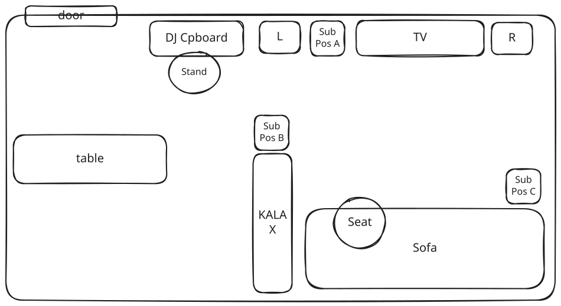
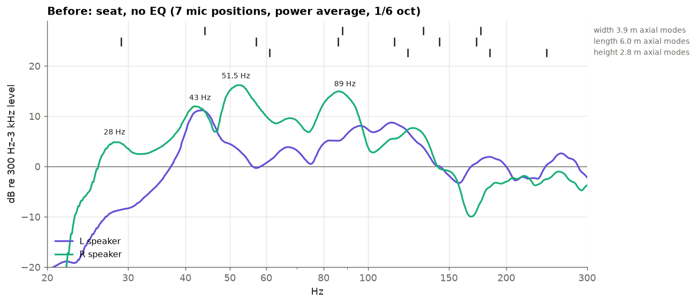
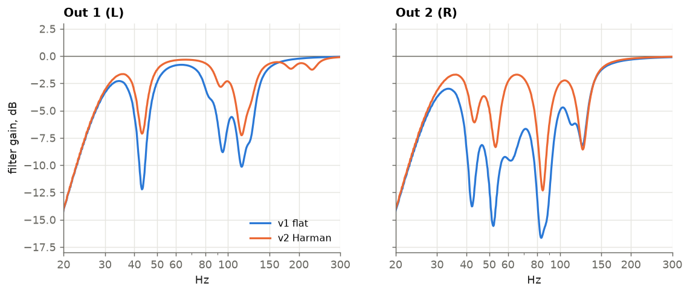
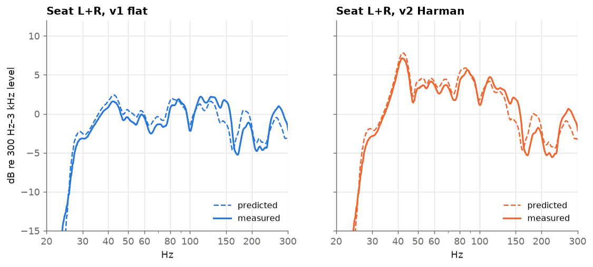
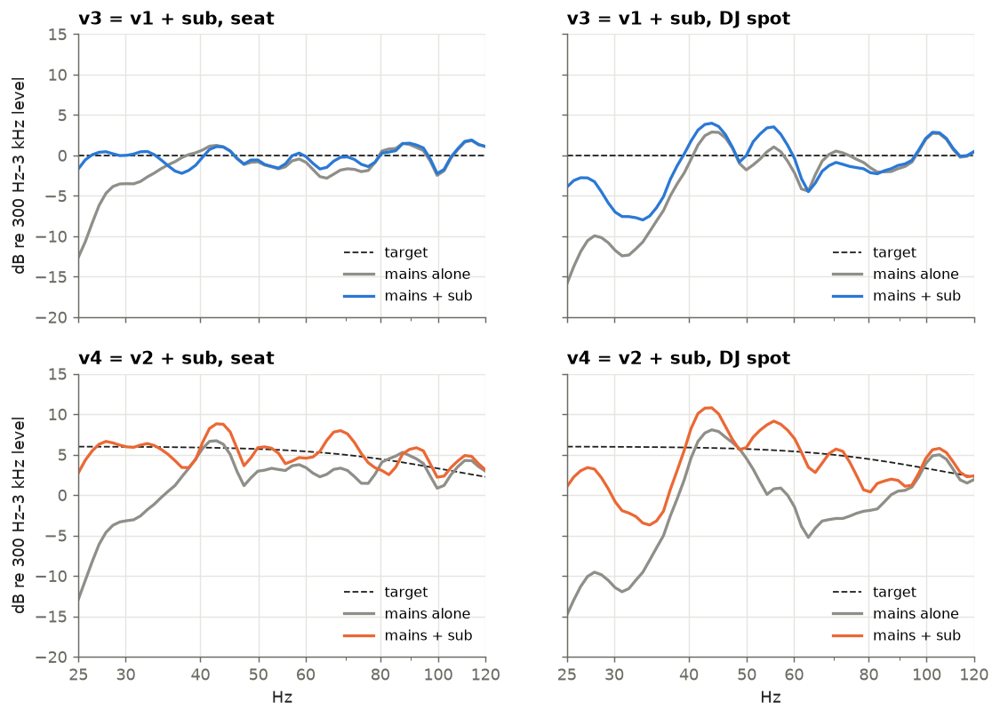

# Taming living-room bass with a small DSP and some Python

A 6.0 × 3.9 × 2.8 m living room, a pair of 2-way floorstanders, a DJ corner and neighbours upstairs.

The goal: even bass at the sofa, and less bass leaking into the rest of the building. The tools: measurements, and an EQ per speaker on a cheap 4-in/4-out DSP. Bass traps are out (no space).

## The short version

Measured with both speakers playing, averaged over 7 mic positions around the seat:

- **The boom is gone.** Before, the bass at the seat sat on average 6.9 dB above the mids, with single room-mode peaks up to +18 dB. With the flat EQ (v1) it's level with the mids (−0.1 dB). With the Harman-style EQ (v2) it's a deliberate +3 dB.
- **Less bass for the neighbours.** In the floor corners, where every room mode is loudest, the bass energy dropped by 7 dB (v1) and 4 dB (v2).
- **Less ringing.** The worst mode (43 Hz) used to keep sounding long after the note: 100 ms later almost all of its energy was still to come. With v1, 14 dB less is left at that moment.
- **The simulation was right.** The EQ was designed on a computer from measurements without any EQ. Measured with the EQ on, the room matches the prediction within 1.5 dB, which is about how much the curve changes when you just set the mic up again.

The sections below go through how each of these was found. Every number links to the detailed finding, the script and the raw data.

## Contents

1. [Room and gear](#1-room-and-gear)
2. [How it was measured](#2-how-it-was-measured) (and how to read the plots)
3. [Before: what the room does](#3-before-what-the-room-does)
4. [EQ design](#4-eq-design)
5. [After: measured in the room](#5-after-measured-in-the-room)
6. [Adding a subwoofer](#6-adding-a-subwoofer)
7. [Checking the tools](#7-checking-the-tools)
8. [Open ends](#8-open-ends)
9. [Glossary](#glossary) · [Reproduce](#reproduce)

## 1. Room and gear



*Sketch, not to scale. The speakers fire across the 3.9 m width toward the sofa. Sub Pos A/B/C were the candidate spots for the subwoofer (section 6).*

- **Room:** 6.0 × 3.9 × 2.8 m, parquet floor (probably on concrete).
  - Furnishing: sofa against the back wall, molton on the walls. Molton only absorbs treble; nothing in the room absorbs bass.
- **Speakers:** Bonsai Akustik Ideal SE, 2-way bass reflex with a Seas 17 cm woofer.
  - The port is tuned to ~35 Hz (measured). Below that a reflex speaker's output falls off steeply.
  - Front baffles are 0.33 m from the wall. R is 0.43 m from the right side wall; L stands roughly in the middle of the 6 m wall. This difference matters a lot (section 3).
- **Seat:** ~4.4 m along the speaker wall, head ~2.75 m out from it (sitting upright at the front of the sofa).
- **DJ spot:** turntables on a cupboard left of L, ~0.75 m from the speaker wall.
- **Signal chain:** TV / DJ mixer → **t.racks DSP 4x4 Mini** → SMSL A300 class-D amp → speakers.
  - Every source goes through the DSP, so every source gets the EQ.
  - Per output the DSP has 7 parametric EQ bands plus a high-pass and a low-pass filter.
- **DSP software:** the vendor editor is Windows-only. The DSP is configured with a home-made browser reimplementation (*tracks*, a separate project) built from the reverse-engineered USB protocol. The EQ is computed by this repo's scripts and imported as filter text files.
- **Measuring:** Behringer UMC404HD interface, Omnitronic MM-1C measurement mic with a calibration file. REW at first, later a [Python sweep script](tools/README.md) (checked against REW, section 7).

More: [docs/context.md](docs/context.md) (room, gear, the problems predicted before measuring), [docs/current-setup.md](docs/current-setup.md) (wiring and DSP presets now).

## 2. How it was measured

Each measurement is a sine sweep through one speaker, recorded by the mic and turned into an impulse response (IR). The IR is the full record of how the room answers that speaker at that mic spot: frequency response, phase, and how long each frequency rings.

**One time reference for everything.** A cable runs from an interface output straight back into an input (a "loopback"). It records the sweep at the moment it leaves the interface, so every IR starts its clock at the same instant.

Why that matters:

- IRs of L and R from the same mic spot can be added up in software with their phase, exactly as the two speakers' sound adds up in the air. That's the **"L+R"** curve: what you hear when both speakers play the same bass, which is how most music is mixed.
- Later, the subwoofer's IR can be added to the mains in the same way. Any filter, delay or polarity setting can then be tried in software without measuring again.

**Several mic positions instead of one.** In bass, the response changes a lot over a few tens of cm. An EQ fitted to one exact point fixes that point and can make things worse 30 cm away.

- So each listening spot gets 7 mic positions: the spot itself plus ±30 cm left/right, ±20 cm forward/back and ±10 cm up/down.
- The 7 curves are power-averaged, the same way the energies would add up.
- Peaks that show up at all 7 positions are real room modes worth cutting. Dips that move around between positions are local cancellations and get ignored.
- Same at the DJ spot. Plus the two reachable floor corners (explained under the leakage point below).

**Putting the mic back in the same place.** To compare two days, the mic has to be at the same spot. Sound needs 2.9 ms per metre, so the arrival time of each speaker's sound gives the mic's distance to that speaker very precisely. Re-placing the mic until both delays match the first day put it back within 1.4 cm ([procedure](docs/procedures/session-checklist.md)).

**Comparing presets fairly.** For the after-measurements, both EQ presets were recalled one after the other at each mic spot without touching the mic. Room, position and temperature were identical for both, so any difference between the two curves comes from the EQ alone.

> **How to read the plots**
>
> - **x-axis:** frequency, 20–300 Hz on a log scale (each octave equally wide).
> - **y-axis: dB relative to the curve's own 300 Hz–3 kHz level** ("vs mids"). The absolute loudness of a measurement depends on the amp knob and the mic gain on that day. The EQ only works below ~250 Hz and leaves 300 Hz–3 kHz alone. So each curve is shifted until its 300 Hz–3 kHz average sits at 0 dB.
>   - After the shift, "0 dB at 50 Hz" means "50 Hz is as loud as the mids", and +10 dB means the bass is 10 dB too loud relative to the rest of the music.
>   - Curves from different days and presets line up directly. A difference between them in the bass is what the EQ (or the room) did.
>   - Check: the mid level stayed within 0.1 dB between the measuring days, so nothing else in the chain had changed.
> - **Smoothing:** 1/6 octave. Narrow wiggles are averaged out; the room modes stay visible.
> - **"rms deviation from target":** the typical distance between the curve and its target over a frequency range, in dB. One number for "how far off is it overall". Lower is better.

Data: [measurements/](measurements/README.md) (REW projects and IR WAV files per set). Processing details (window, calibration, smoothing): [analysis/README.md](analysis/README.md).

## 3. Before: what the room does

The seat with no EQ, each speaker on its own. The tick rows at the top mark the frequencies where the room's three dimensions should resonate (axial modes, computed from the room size before measuring):



**Every big peak lines up with a predicted room mode.** A room mode is a frequency whose half-wavelength (or a multiple) fits exactly between two walls. Sound at that frequency bounces back and forth and builds up into a standing wave.

| Peak | Cause |
| --- | --- |
| 43–44 Hz, both speakers | half a wavelength = the 3.9 m width (speaker wall to sofa wall) |
| 51.5 Hz, R | a tangential mode: length and width combined |
| 86–89 Hz, R | two modes stacked: the 2nd width mode (88 Hz) and the 3rd length mode (86 Hz) |
| 28 Hz, R | half a wavelength = the 6 m length |

**R has far more bass than L** (+5…+13 dB at 25–35 and 50–90 Hz), although the two speakers are identical.

- First check: is the R speaker itself louder? Close-up measurements with the mic 1 cm from each woofer match within ±1 dB. So it's not the speaker.
- It's the position. How strongly a speaker drives a mode depends on where it stands in that mode's standing wave: at a pressure maximum it couples fully, at a pressure null not at all.
- L stands in the middle of the 6 m wall. That's exactly the null of the 1st and 3rd length modes (29 and 86 Hz), so L hardly excites them.
- R stands near the side wall, where every length mode has a pressure maximum, so R drives all of them.

**R has a −14 dB dip at 173 Hz.** It's at the same frequency at every mic position, so it comes from the speaker, not from where the mic is.

- Sound from the speaker reflects off the walls right behind and beside it and comes back out of phase at the frequency where the path difference is half a wavelength. The two cancel.
- An EQ boost can't fill this: it boosts the direct sound and the reflection equally, and they still cancel. So it's left alone.

**At the DJ spot there's plenty of bass in general** (43 Hz is even +15 dB there), but there are two holes:

- 30–35 Hz: both speakers are weak there.
- 55–75 Hz: each speaker alone is +5…+9 dB, yet L+R together is ~0 dB. The two speakers' sound arrives out of phase at that spot and cancels. EQ can't fix that: a boost makes both speakers louder, and they still cancel.

**The bass rings.** The 63 Hz octave takes 0.66 s to decay by 60 dB. Everything from 125 Hz up decays in 0.25–0.4 s, which is normal for a furnished living room. Long ringing is what makes bass sound "boomy" and blurs bass lines.

Details: [findings/2026-11-18-baseline.md](findings/2026-11-18-baseline.md) (peak tables with the spread across positions, corners, DJ spot, close-ups).

## 4. EQ design

The EQ is computed by a script ([design_eq.py](analysis/design_eq.py)), not set by hand in REW. It follows a few rules, each for a reason:

- **Only cuts, never boosts.**
  - A room mode is a peak that exists everywhere in the room. Cutting it at the source lowers it at every position, and also lowers the bass that leaks out of the room.
  - A dip is usually local (it moves when you move) or a cancellation (see above). Boosting it costs amp power and woofer excursion, and helps at best one spot.
- **Fitted on all the measured IRs at once, not on one averaged curve.** For every candidate filter set, the script applies the filters to each IR in software and recomputes all curves, including L+R. That way it sees how the filters change the way L and R add up, not only their levels.
  - What counts how much: seat L+R most (1.0), seat L and R alone 0.5 each, DJ spot L+R 0.4.
- **Too much counts, too little only if the EQ caused it.** Where the curve is above target, every dB is penalised. Where it's below target, only the part the filters themselves dug deeper counts, so the script doesn't try to "fix" dips by refusing to cut nearby peaks. A small penalty per dB of cut keeps it from cutting more than necessary.
- **Designed in the DSP's own steps.** The DSP can't set any value: frequency comes in 1/30-octave steps, Q in 1/12-octave steps, gain in 0.1 dB steps up to ±12 dB. The script picks only values the DSP can hold, so what's loaded is exactly what was simulated, with no rounding at import.
- **High-pass at 29.8 Hz** (Butterworth, 24 dB/octave) on both speakers. Below the 35 Hz port tuning the woofer's cone is no longer held back by the port and moves a lot for little sound. With DJ material that's risky.

**Two targets, two presets:**

- **v1, flat:** bass at the same level as the mids (0 dB in the plots). After listening it sounded "boring" at normal volume.
- **v2, Harman-style:** a gentle bass shelf, +6 dB at the bottom, half of that around 100 Hz, fading out above ~200 Hz. Listening tests at Harman (the speaker company) found that most listeners prefer this kind of bass rise in a room over flat.

The resulting filters (what the DSP does to the signal, before the room). The left part is the high-pass; each notch is a cut at one room mode. R needs more and deeper cuts because it drives more modes (section 3):



Filter values: [eq/v1-flat/](eq/v1-flat/), [eq/v2-harman/](eq/v2-harman/). The design method with background on each step: [docs/eq-design-explained.md](docs/eq-design-explained.md) (also as an [interactive page](explainer/eq-explained.html)). Design findings: [v1](findings/eq-v1-flat.md), [v2](findings/eq-v2-harman.md).

**Treble: checked and left alone.** The Harman curve also falls gently in the treble, about 1 dB per octave above 1 kHz. Measured at the seat, these speakers already do that by themselves (−0.9 dB/octave for L, −1.4 for R), so no treble filter was added ([treble check](findings/eq-v2-harman.md#treble-tilt-checked-not-added-2026-11-18)).

## 5. After: measured in the room

Four days after the "before" measurements, with each EQ loaded on the DSP. Both speakers playing (L+R), 7 positions averaged. Grey is the room without EQ; the thin dotted and dashed lines are the two targets:


How loud the bass is compared with the mids (average over the band, in dB):

| L+R, 7 positions | no EQ | v1 | v2 | v2 target |
| --- | --- | --- | --- | --- |
| Seat, 30–60 Hz | +7.1 | −0.6 | +2.7 | +5.8 |
| Seat, 60–150 Hz | +6.7 | +0.3 | +3.3 | +3.5 |
| DJ spot, 30–60 Hz | +4.4 | −2.8 | +0.1 | +5.8 |
| Floor corners, 30–150 Hz | +16.3 | +9.2 | +12.5 | |

How to read this:

- **At the seat, v1 hits its flat target almost exactly**, and v2 hits its target above 60 Hz.
- **v2 stays ~3 dB short of its target at 30–60 Hz.** That's expected, and it's the limit of a cut-only EQ: it can lower the peaks to the target, but it can't lift what's below the target.
  - Below 35 Hz the speakers themselves run out (port tuning plus the protective high-pass).
  - Between the modes there are dips. This is the gap a subwoofer could fill (section 6).
- **The floor corners show what leaks into the building.** In a room corner every mode has a pressure maximum, so a corner hears the total of all modes and none of the dips. It's the best measurable stand-in for "how much bass energy is in the room", and that energy is what goes through walls, floor and door.
  - The corners went from +16.3 dB to +9.2 dB (v1) and +12.5 dB (v2).
  - That's the 7 dB and 4 dB from the summary. v2 trades some of that for the fuller sound.
- **At the DJ spot, v2 ends up further from its target at 65–85 Hz** than without EQ. That's the band where L and R cancel at that spot (section 3). The cuts made for the seat lower the already weak sum there a little more. The simulation showed this before it was loaded, and it was accepted as the price for the seat.

**Did the room do what the simulation said?**

"Predicted" below means: take the IRs measured *without* EQ, apply the filter files in software, and compute the curve. "Measured" means: load the EQ on the DSP and measure again, four days later.



- The two curves are 1.5 dB apart on average at the seat and 1.6 dB at the DJ spot (rms, 25–250 Hz, 1/24 octave).
- That's about as much as the curves change when the mic is set up again. So the simulation is as good as the measurement can tell.
- **A stricter check that doesn't depend on the mic position:** at each spot v1 and v2 were measured with the mic untouched, so the measured difference v2 − v1 comes from the filters alone.
  - Compared with the difference between the two filter files, it's within 0.25–0.8 dB at every position.
  - So the DSP's filters do exactly what was designed, in the room, not only on the bench.

**Ringing.** An EQ cut doesn't make a room mode decay faster: the mode still loses the same number of dB per second. But it starts from a lower level, so at every moment afterwards it's quieter, and it drops below the music and the background sooner.

The plot shows this as "energy still to come": at each moment after the sound starts, how much of that frequency band's sound is still to arrive (Schroeder integration, 1/6 octave, mean of the seat positions).

- 0 dB is the total of the no-EQ curve.
- A curve that starts lower means the mode is weaker from the start.
- Read the value at e.g. 100 ms to see how much is still ringing then.


| Energy still to come 100 ms after the sound starts | no EQ | v1 | v2 |
| --- | --- | --- | --- |
| Seat, L, 43 Hz | −2.6 dB | −16.9 dB | −11.1 dB |
| Seat, R, 52 Hz | −3.8 dB | −21.2 dB | −12.6 dB |
| Seat, R, 84 Hz | −11.0 dB | −34.3 dB | −24.4 dB |

For example: without EQ, 100 ms after a 43 Hz note starts, its energy is only 2.6 dB below the start, so it has barely begun to decay. With v1 it's 16.9 dB below.

**Listening (by ear, not measured):**

- v1 sounds thin at moderate volume and just right when played loud.
  - That's expected: the ear's sensitivity to bass drops more than to mids as the volume goes down (the equal-loudness contours). So the quieter you listen, the more bass you need to hear it as balanced.
- v2: "more subby, not boomy", and better at low volume. It's now the everyday preset; v1 is for loud sessions.
- Some bass is still audible outside the room, depending on where you stand.

Details: [findings/2026-11-22-eq-room.md](findings/2026-11-22-eq-room.md), [findings/2026-11-20-listening.md](findings/2026-11-20-listening.md).

## 6. Adding a subwoofer

The gap left by the EQ is below ~40 Hz: the speakers can't go deeper, and a cut-only EQ can't add anything.

The fix tried here: a PreSonus Eris Sub8 on the DSP's third output, as an **add-on**.

- The main speakers keep running full range with exactly the same EQ.
- With the sub off, the system sounds exactly like v1 / v2 before.
- The sub is meant only to add 25–40 Hz.

**Where to put it: a model first.** There were three possible spots (A, B, C in the sketch). Instead of measuring all three, a simple room model was used to rank them:

- The model treats the room as an empty rectangular box with rigid walls and computes the modes (no furniture, no doors).
- It was checked against reality first. It predicts the difference between R and L at the seat reasonably well (correlation 0.61; the 28, 51 and 89 Hz peaks within ~3 dB). Good enough to rank positions, not to predict exact levels.
- **Spot A** (next to L) would mostly add 44 Hz, the frequency that already has the biggest peak.
- **Spot B** (open floor, mid-room) is smooth, but sits near the nulls of the low modes, so the sub would need ~10 dB more power for the same bass at the seat.
- **Spot C** (right wall, next to the sofa) drives the 28.6 Hz length mode, exactly the low end that's missing. So C was measured.
- Details: [findings/2026-11-20-sub-positions-model.md](findings/2026-11-20-sub-positions-model.md).

**Measured at C, combined in software.**

- The sub alone was measured at 16 positions (seat, DJ spot, corners), on the same day and at the same spots as the main speakers.
- All IRs share the loopback time reference (section 2), so the sub's IR can be added to the mains' IR in software, with any filter, delay and polarity setting applied.
- A script searched for the settings that bring mains + sub closest to each preset's target (25–120 Hz, seat weighted 2/3, DJ spot 1/3). All in the DSP's own steps, as for the main EQ:
  - Low-pass filter type and frequency (where the sub fades out).
  - Polarity and delay. The sub sits elsewhere in the room than the mains, and its own filter delays its sound, so its wave arrives at the seat shifted against theirs. Polarity and delay line them up so they add instead of cancel where both play (~30–50 Hz).
  - Level, and two EQ cuts.

Result: grey is the main speakers alone with their EQ, the coloured line is mains + sub, dashed is the target:



| | v3 = v1 + sub | v4 = v2 + sub |
| --- | --- | --- |
| Sub low-pass | Butterworth 24 dB/oct, 32.7 Hz | Linkwitz-Riley 24 dB/oct, 52 Hz |
| Polarity, delay | inverted, 5.5 ms | inverted, 6.9 ms |
| EQ cuts on the sub | 29.2 Hz −8.0 dB, 45.2 Hz −12.0 dB | 28.5 Hz −4.8 dB, 47.4 Hz −12.0 dB |
| rms deviation from target, 25–120 Hz | 4.2 dB → 2.2 dB | 7.1 dB → 2.6 dB |

How to read this:

- **The low end now reaches the target down to 25 Hz.** The curve's typical distance from the target halves (v3) or drops to a third (v4). v4 gains more because its target asks for more low bass.
- Polarity inverted and a 5.5–7 ms delay came out in every run of the search and for both presets, so they reflect the real acoustic situation and aren't a fitting accident.
- The sub's cut at 45–47 Hz is there because at C the sub excites the 45–50 Hz mode at the seat. The second cut (28–29 Hz) is explained in the next bullet.
- **It's robust:** every single seat and DJ position gets closer to the target, not just the average. Only one floor corner gets slightly worse.
- **No overshoot at 28 Hz.** The first search left the seat +4 dB above target there: the 28.6 Hz mode the model predicted for spot C. The deepest bass also travels through buildings best, so the search now penalises overshoot at the seat below 35 Hz and gets a cut-only band at 25–32 Hz. Seat now within +0.6 dB; the DJ spot drops ~3 dB below target at 28 Hz in exchange ([details](findings/2026-11-22-sub-c-28hz.md)).
- **The DJ spot's 31–35 Hz hole stays.** The sub has the same hole there; spot C doesn't reach it.
- **Practical catch:** the amp's volume knob only controls the main speakers; the sub has its own amp. So the sub is level-matched for one amp position per preset, and is meant for loud sessions at that position.
- Loaded on the DSP as presets P05 / P06. First listen to P05 (v3 + sub): the first design was too subby, the second "sounds great" at ~70–75 dB(C); almost no leakage into other rooms, mostly through the door ([listening notes](findings/2026-11-22-sub-listening.md)). P06 not listened to yet.

Details: [findings/2026-11-22-sub-c.md](findings/2026-11-22-sub-c.md).

## 7. Checking the tools

Everything above relies on two assumptions: the DSP applies the filters exactly as the maths says, and the sweep measurements are right. Both were tested.

**Does the DSP do what the maths says?**

- DSP output cabled straight into the interface: no amp, no speaker, no mic, no room. What's measured is only the DSP's filters.
- Compared with the response computed from the filter files:
  - within 0.03–0.04 dB from 60 to 150 Hz;
  - within 0.2 dB from 30 to 60 Hz.
- Every notch sits at its design frequency and depth.
- Earlier tests in the *tracks* project had suggested the DSP's EQ frequencies come out up to 41 cents (~2.4 %) low below 150 Hz. With a long sweep that doesn't show up, so it was most likely an artefact of the shorter test measurement there.
- Findings: [v1](findings/eq-v1-flat.md#dsp-electrical-check), [v2](findings/2026-11-22-eq-v2-electrical.md).

**Is the home-made sweep script as good as REW?**

- Same electrical setup, one REW sweep against three Python sweeps: within 0.016 dB from 20 Hz to 20 kHz, timing within one sample.
- Both also agree within 0.02 dB with steady sine tones, a completely different method that doesn't use sweeps at all.
- At the seat, REW vs Python differs less than two Python sweeps in a row do. The room itself changes slightly from sweep to sweep (people, air), and that limits any room comparison, not the tool.
- Finding: [sweep validation](findings/2026-11-22-sweep-validation.md).

**Found on the way:**

- REW's sweep level setting means the peak level, not the RMS level (not obvious from its UI).
- Recalling a DSP preset disturbs its output for about 2 s; the script now waits after a recall.
- One preset makes the DSP output some very low-frequency noise (2–12 Hz, −59 dBFS). It comes from the EQ bands themselves and is inaudible.
- The L speaker has a very narrow resonance at ~78 Hz that rings for ~2.5 s.
  - That's far narrower than any room mode, so it's mechanical: something in or on the speaker.
  - It's in every L measurement on both days, including the close-ups at the woofer.
  - It's too narrow to show in a normal frequency response, and nothing audible rings even with a 78 Hz sine tone.
  - Finding: [78 Hz resonance](findings/2026-11-22-eq-room.md#narrow-resonance-at-78-hz-in-the-l-speaker).

## 8. Open ends

- Listen to the sub presets, then measure mains + sub together for real (so far the combination is only computed).
- An output limiter on the DSP, so the system can't go louder than a sensible maximum whatever the TV or amp is set to.
- Scan the room with an iPhone, build a room model, and find out where absorbers would fit and help.
- Speakers on concrete slabs on soft pads, to reduce bass travelling through the floor.

Current state and next steps: [SESSION-LOG.md](SESSION-LOG.md). Plans: [docs/plans/](docs/plans/). Why things were decided: [docs/decisions.md](docs/decisions.md).

## Glossary

| Term | Meaning |
| --- | --- |
| IR | impulse response: the room's answer to one speaker at one mic spot, computed from a sweep |
| L, R | left / right main speaker (DSP outputs 1 and 2) |
| L+R | both speakers playing the same bass, computed by adding their IRs with phase |
| room mode | a frequency that resonates between walls; loud at some spots, silent (null) at others |
| vs mids | relative to the curve's own 300 Hz–3 kHz average; all bass levels on this page are given this way |
| rms deviation | the typical distance between a curve and its target over a frequency range, in dB |
| v1 / v2 | EQ for the main speakers with a flat / Harman-style target |
| v3 / v4 | v1 / v2 plus the subwoofer |
| P01…P06 | DSP preset slots: P01 no EQ, P02 v1, P03 v2, P04 sub measuring, P05 v3, P06 v4 |
| Out 3 | the DSP output feeding the subwoofer |
| seat | main listening position, plus 6 positions around it for the average |
| DJ spot | standing ear height in front of the turntables, plus 6 positions |
| floor corners | the two reachable corners on the speaker wall: a stand-in for total bass energy in the room, not a listening spot |
| Sub Pos A / B / C | candidate subwoofer spots (sketch); C was measured and used |
| amp 45 / 50 | SMSL A300 volume position (1 dB per step) |

## Reproduce

```sh
mise run analyse   # installs the Python deps (uv) and runs every analysis script; plots and full text output go to analysis/output/
```

The plots on this page come from [analysis/build_writeup.py](analysis/build_writeup.py). It only draws; the curves are computed by `analyse_eq_room.py` and `analyse_sub_c.py`. All scripts and what they print: [analysis/README.md](analysis/README.md).
