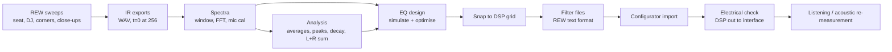
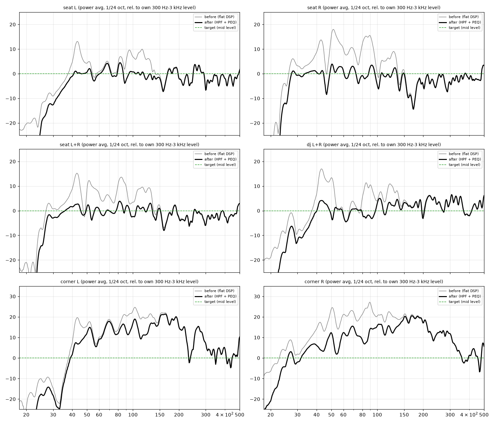
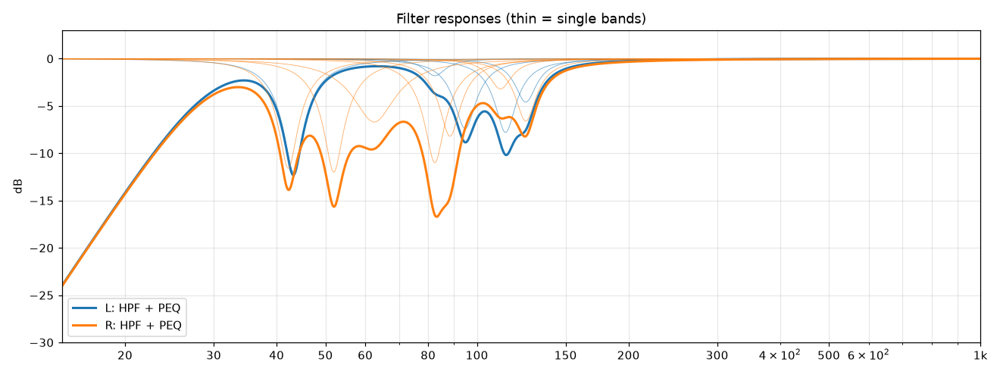

# How the room EQ was designed

This explains how the EQ now in the DSP was made, step by step. Each step includes the background needed to follow it. The numbers are the real ones from this room (2026-11-18).

Where things live:

- Measurement findings: [measurements/2026-11-18-analysis.md](measurements/2026-11-18-analysis.md)
- Scripts: [analysis/](analysis/README.md); the EQ design is [analysis/design_eq.py](analysis/design_eq.py)
- Filter files: [eq/](eq/)
- Room, gear and goals: [room-acoustics-context.md](room-acoustics-context.md)

Contents

1. [The problem: why bass in a small room is uneven](#1-the-problem-why-bass-in-a-small-room-is-uneven)
2. [What EQ can and can't do](#2-what-eq-can-and-cant-do)
3. [Measuring: from a sweep to a frequency response](#3-measuring-from-a-sweep-to-a-frequency-response)
4. [What the measurements showed](#4-what-the-measurements-showed)
5. [The filters: biquads, peaking EQ and the high-pass](#5-the-filters-biquads-peaking-eq-and-the-high-pass)
6. [Simulating the EQ before it exists](#6-simulating-the-eq-before-it-exists)
7. [Finding the filters: the optimisation](#7-finding-the-filters-the-optimisation)
8. [Fitting the design to the DSP](#8-fitting-the-design-to-the-dsp)
9. [Checking it](#9-checking-it)
10. [Results](#10-results)
11. [Limits and what comes next](#11-limits-and-what-comes-next)
12. [Glossary](#12-glossary)

---

## 1. The problem: why bass in a small room is uneven

### Room modes

Sound is a pressure wave. Between two parallel walls, a wave whose half wavelength fits the distance exactly bounces back and forth and reinforces itself: a **standing wave**, or **room mode**. Its frequency is

  f = n · c / (2 · L)  (c = 343 m/s, L = distance between the walls, n = 1, 2, 3 …)

For this room (6.0 × 3.9 × 2.8 m):

| Dimension | Modes (Hz) |
| --- | --- |
| 3.9 m (speaker wall → sofa) | 44, 88, 132, 176 … |
| 6.0 m (along the speaker wall) | 29, 57, 86, 114 … |
| 2.8 m (height) | 61, 122, 184 … |

These are the **axial** modes (between one pair of walls). There are also tangential and oblique modes (between 4 or 6 surfaces), which are weaker.

A mode has fixed **loud spots** (pressure maxima, always at the walls) and **quiet spots** (nulls). For the first mode the null is in the middle of the room. At a mode frequency, a speaker that excites the mode makes the room "ring": the level at a loud spot can be 10–20 dB above the rest of the spectrum, and the sound keeps going after the source stops.

Below about 150–200 Hz the modes are far enough apart that each one stands out on its own. Above that they overlap so densely that the room behaves "statistically" and reflections dominate. That boundary is the **transition frequency**, and the reason the EQ only works below ~150 Hz.

### Why it matters here

- **The sofa is against a wall.** Every mode along the 3.9 m axis is at its loudest there, so 44 Hz and 88 Hz boom at the seat.
- **L and R sit in different places.** L is in the middle of the 6 m wall, which is the null of the odd length modes (29 Hz, 86 Hz), so it hardly excites them. R is near the side wall, so it excites all of them. That is why R measured with much more bass than L, even though the two speakers are identical (confirmed by the close-up measurement).
- **Bass leaking into the staircase** is the room's mode energy. A mode that rings throughout the room pushes on the walls, doors and floor everywhere, not only at the seat.

### Other effects in the bass

- **Boundary cancellation (SBIR):** the wave from the speaker and its reflection off the wall behind it arrive out of phase at one frequency, about c / (4 · distance). This makes a dip, e.g. R's −14 dB dip at 173 Hz.
- **Cancellation between L and R:** where the two speakers' paths differ by half a wavelength they cancel each other. At the DJ spot this happens at 55–75 Hz.

---

## 2. What EQ can and can't do

EQ changes how much signal goes to the speaker at each frequency. That leads to two simple rules:

**A peak can be cut.** If the room adds +13 dB at 43 Hz, sending 12 dB less at 43 Hz brings it back down, and it does so everywhere in the room, because the speaker excites the mode less. This helps both goals: an even response at the seat and less energy leaking out.

**A dip can't be filled.** A null or a cancellation means two waves arrive at that spot and cancel. Boosting sends more of both waves, and they still cancel. Meanwhile the extra energy goes into the rest of the room. Boosting a null is also expensive: +6 dB means 4× the amplifier power and 2× the cone excursion.

That's why the design is **cut-only**, and why it doesn't spend effort on dips.

A practical way to tell the two apart is to **move the mic**. A mode peak stays at the same frequency when the mic moves 30 cm; a cancellation dip moves or changes its depth a lot. That's what the 7-position measurement at the seat was for (see §4).

A further benefit, worth knowing: in the bass, at a single position, a room mode behaves roughly like a **minimum-phase** system. In such a system, magnitude and timing are linked, so cutting the peak also shortens the ringing. The EQ removes boom in level and in time. (This is a common rule of thumb; the acoustic re-measurement with a waterfall plot will show how well it holds here.)

---

## 3. Measuring: from a sweep to a frequency response

### The sweep and the impulse response

REW plays a **sine sweep** (a tone gliding from 10 Hz to 22 kHz in about 11 s) and records it with the mic. Dividing the recording by the original sweep (deconvolution) gives the **impulse response (IR)**: what the mic would record if the speaker played one infinitely short click.

The IR contains everything about the path speaker → room → mic, because the system is **linear and time-invariant (LTI)**: the output for any signal follows from the IR. The sweep is used rather than a real click because it puts much more energy into the room, so the result has far less noise.

What an IR looks like here:

- about 9 ms of silence (the sound travelling ~3.2 m to the seat),
- a big spike (the direct sound),
- small spikes 1–6 ms later (early reflections from floor and walls),
- a long, decaying tail (reverberation; in the bass, mostly ringing modes).

### Timing reference (loopback)

Interface Out 3 is wired straight to In 2. REW sends a reference signal there, so it knows exactly when the sweep left the interface. Every IR therefore has the same time zero, which is what makes it possible to add L and R IRs later (§4) and get the correct timing between them.

### The export

Each measurement was exported from REW as a WAV file: 32-bit float, t = 0 at sample 256, no normalising or windowing. So all the processing below is done in our own scripts, in the open.

### From IR to frequency response

The scripts do this for each IR:

1. **Window: 500 ms.** Only the first 500 ms after the start are kept, with the last quarter faded out smoothly. 500 ms is long enough to include the full build-up of the bass modes (they are what we want to see), and short enough to cut off the noise floor that follows. It sets the true frequency resolution to about 1 / 0.5 s = 2 Hz.
2. **FFT** (Fast Fourier Transform) with 2^18 points. The result is a complex number for every frequency in 0.18 Hz steps: a **magnitude** (how loud) and a **phase** (how delayed). The fine steps come from zero padding; they make the curves smooth but don't add real resolution beyond the ~2 Hz.
3. **Mic calibration.** The MM-1C's own response (from its cal file) is subtracted. For example, it is 3.5 dB less sensitive at 20 Hz. The 90° file is used with the mic pointing at the ceiling; the 0° file for the close-ups pointing at the speaker.
4. **Level.** A fixed offset makes the left seat measurement read 73.5 dB from 1 to 8 kHz, matching REW's calibrated SPL within about 1 dB.

### Smoothing

A raw room response is very jagged. **Fractional-octave smoothing** averages each point with its neighbours within, e.g., 1/24 of an octave. It is done on **power** (squared magnitude), not on dB, so that loud peaks keep their real weight.

- 1/24 octave in the bass: keeps individual modes visible.
- 1/6 octave for overviews and the mid level.

### Averaging over positions

One mic position is a snapshot. Move your head 30 cm and the curve changes, mostly at the dips. So each speaker was measured at the seat plus 6 points around it (±30 cm left/right, ±20 cm forward/back, ±10 cm up/down), and the 7 responses were **power-averaged**: average the power at each frequency, then convert back to dB.

Power averaging (rather than averaging the complex values) is right here because the phase between positions is effectively random. A complex average would let positions cancel each other and invent dips. The power average shows the energy that is present across the listening area. It also gives each frequency a **spread** (how much it varies between positions), which is how mode peaks (small spread) were told apart from cancellations (large spread).

### The reference level

Everything is shown relative to each set's own average level from 300 Hz to 3 kHz (the "mid level"). "+13 dB at 43 Hz" means 13 dB above the mids. The target of the EQ is 0 dB on that scale: bass as loud as the mids.

---

## 4. What the measurements showed

| Measurement | What it answered | Key result |
| --- | --- | --- |
| Seat + 6 positions, L and R | Which peaks are stable across the listening area | L: 43 Hz +13, broad 90–120 Hz hump +10. R: 52 Hz +18, 89 Hz +15, 43 Hz +14, 68 Hz +10, 128 Hz +9. Dips (R 173 Hz) not EQ-able. |
| Decay (RT60) | How long the bass rings | 63 Hz octave ~0.7 s, longer than the 0.3–0.5 s target; above 125 Hz fine |
| Two floor corners | Room energy as a whole (all modes are loudest in corners) | Confirms the same peaks; R 89 Hz and 51 Hz loudest (~100 dB in the corner) |
| DJ spot, 7 positions | What the DJ hears | Same peaks as the seat, plus holes at 30–35 Hz and 55–75 Hz |
| L+R sum (calculated) | What you hear when both speakers play the same bass | At the seat, +5 to +15 dB above the mids from 40 to 130 Hz. At the DJ spot, L and R cancel at 55–75 Hz. |
| Close-up woofer/port | Speaker alone, without the room | Port tuned to ~35 Hz; L and R woofers identical, so R's extra bass is the room |

### The L+R sum

Music has mostly mono bass: both speakers play the same bass signal at once. At the mic the two waves add up **with their phases**, which can reinforce or cancel. With the shared loopback timing, adding the L and R spectra as complex numbers gives exactly what the mic would have recorded with both speakers playing:

  H_L+R(f) = H_L(f) + H_R(f)

This sum was calculated at every seat and DJ position, then power-averaged over the positions as before. It is the most important curve for the design, because it's what you hear most of the time.

---

## 5. The filters: biquads, peaking EQ and the high-pass

### What a digital filter is

The DSP runs at 48 kHz. Each EQ band is a **biquad**: a small formula that computes each output sample from the current and last two input samples and the last two output samples:

  y[n] = b0·x[n] + b1·x[n−1] + b2·x[n−2] − a1·y[n−1] − a2·y[n−2]  (all divided by a0)

Five numbers (the coefficients) define the filter. Its frequency response is

  H(z) = (b0 + b1·z⁻¹ + b2·z⁻²) / (a0 + a1·z⁻¹ + a2·z⁻²),  with z⁻¹ = e^(−j·2π·f/48000)

which is a complex number per frequency (a gain and a phase shift), just like the measurement.

### The peaking filter

A **peaking EQ** (type "PK" / "Peak") cuts or boosts a bell-shaped region around a centre frequency. The standard formulas come from Robert Bristow-Johnson's "Audio EQ Cookbook" (RBJ):

  A = 10^(Gain / 40), ω = 2π · Fc / 48000, α = sin ω / (2 · Q)

  b0 = 1 + α·A, b1 = −2·cos ω, b2 = 1 − α·A
  a0 = 1 + α/A, a1 = −2·cos ω, a2 = 1 − α/A

Three parameters:

- **Fc**: the centre frequency, where the cut is deepest.
- **Gain**: how deep (negative = cut).
- **Q**: how narrow. The width is roughly Fc / Q. A Q of 8 at 43 Hz is about 5 Hz wide.

### How narrow should a cut be?

A room mode itself has a width, set by how quickly it decays. A mode with decay time T60 has a bandwidth of about 2.2 / T60. With T60 ≈ 0.5 s that's ~4.4 Hz, which at 43 Hz is a Q of about 10. So Q values of 5–10 match the modes here. Much narrower would be too fragile (a mode shifts a few Hz with temperature, furniture or listening position); much wider would also cut the music around the mode.

### The high-pass filter

The DSP has a separate high-pass filter (HPF) per output, outside the 7 PEQ bands. It is set to **Butterworth, 24 dB/octave, 29.8 Hz**:

- **Why:** the speaker's port is tuned to ~35 Hz. Below the tuning, the port no longer holds back the cone, so the cone moves much further for little extra sound. With bass-heavy music that means distortion and possible damage, plus deep bass energy leaking out.
- **Why 29.8 Hz:** a little below the tuning protects the woofer, and costs only ~1 dB at 35 Hz at the seat. The design script also compared 25/30/35/40 Hz; 35 Hz would cost ~2 dB more at 35 Hz and reduce bass energy by only 0.4 dB more.
- **Butterworth 24** is a standard 4th-order design: maximally flat above the cutoff, −3 dB at the cutoff, then falling 24 dB per octave.

---

## 6. Simulating the EQ before it exists

This is the central trick of the method.

Because the whole chain is linear, the filter and the room simply multiply in the frequency domain:

  what the mic would record with EQ = (measured spectrum) × (filter response)

That's true for each complex frequency value, at each mic position. So for any candidate EQ, the script can compute exactly what each of the 32 measurements (7 seat × 2 speakers, 7 DJ × 2, 2 corners × 2) would have looked like with the EQ on, without anyone re-measuring.

Details that matter:

- The multiplication is done on **complex** values, so the filters' phase shifts are included. This matters for the L+R sum: a filter on R alone changes R's phase near its frequency, which changes how R adds up with L.
- L gets L's filters, R gets R's filters, and then the sums are formed. So the simulation shows what the stereo pair does, not just each speaker alone.
- After filtering, the same steps as in §3 follow: smoothing, power average over positions, relative to the mid level.

The same machinery gives the "before" curves (filter = 1) and all the "after" numbers in §10.

---

## 7. Finding the filters: the optimisation

The question is: which 7 (or fewer) cuts per channel make the simulated response as close to the target as possible? This is solved numerically.

### Target and fit range

- **Target:** flat at the mid level (0 dB) from 25 to 250 Hz. No bass boost, as the goals require (less leakage).
- **Resolution:** 1/24-octave smoothing, evaluated on a log-spaced frequency grid, so that 30–60 Hz counts as much as 120–240 Hz (equal weight per octave, like hearing).

### The cost function

The optimiser needs one number that says how bad a candidate EQ is. Here it's a sum of four terms, each describing how far one simulated curve is from the target:

| Curve | Weight | Why |
| --- | --- | --- |
| Seat L+R | 1.0 | What you hear most (mono bass) |
| Seat L alone | 0.5 | Stereo content, and so the L channel isn't distorted just to fix the sum |
| Seat R alone | 0.5 | Same for R |
| DJ spot L+R | 0.4 | So the DJ spot gets better too, and isn't made worse where it's already thin |

Within each term the error is **asymmetric**:

- Where the curve is **above** the target, the excess counts in full (squared error). These are the peaks to remove.
- Where the curve is **below** the target, it only counts if the EQ made it worse. A dip that was already there costs nothing, because the EQ can't fix it. But if a cut deepens a dip, that costs.

Example: at the seat, 55 Hz sits at +9 dB → this pushes for a cut. At the DJ spot, 60 Hz is already at −1 dB because of the L/R cancellation → no reward for cutting there, and a penalty if a cut around 60 Hz deepens it. The optimiser has to find a compromise; it ended up with a moderate R cut at 62.5 Hz, which makes the DJ spot about 1 dB thinner there.

Finally, a small **penalty per dB of total cut** (0.005 per dB). Without it, the optimiser sometimes wastes bands on tiny cuts or stacks two bands on the same mode. With it, a band has to earn its place.

### The search

Each band has three numbers (Fc, Gain, Q), so 2 channels × 7 bands × 3 = 42 parameters. The steps:

1. **Starting guess:** the biggest peaks in each channel's seat average, each with a cut of 70 % of its height and Q 4.
2. **Optimiser:** L-BFGS-B (a standard gradient-based method that respects limits) moves all 42 numbers at once to lower the cost. Limits: Fc 25–250 Hz, gain −12 to 0 dB (cut only), Q 0.7–8. Frequency and Q are optimised on a log scale, because a step from 40 to 44 Hz matters as much as one from 100 to 110 Hz.
3. **Restarts:** this kind of problem has many local minima, so it runs three times from slightly shuffled starting points and keeps the best.
4. **Merge and re-fit:** if two bands end up within 1/12 octave of each other (two bands on one mode), they're merged into one and the smaller set is re-fitted. L ended up with 5 bands, R with all 7.

### How the limits were found (the iterations)

The first run allowed Q up to 10. Most bands went straight to Q 10, and some were stacked in pairs on the same frequency. That's a sign of **overfitting**: the optimiser was tailoring very narrow notches to the exact shape of the averaged curve, which won't hold up when you move your head. So:

- Q capped at 6, plus the cut penalty → no more stacking, but the 43 Hz mode was under-cut (a single Q 6 band was too wide for it).
- Q cap raised to 8 → in line with the mode widths from §5, and the 43 Hz mode is handled by one band.
- Gain limited to −12 dB per band: the first files had −12.6 and −13.8 dB, and the configurator rejected them, because the DSP allows ±12 dB.

---

## 8. Fitting the design to the DSP

The DSP doesn't accept arbitrary values. Its settings are integers on fixed grids (from the reverse-engineered protocol, `tracks/docs/protocol.md`):

| Parameter | Device grid | Step size here |
| --- | --- | --- |
| Gain | (raw − 120) / 10 dB, −12 … +12 | 0.1 dB |
| Frequency | 1000 · 2^((raw − 170)/30) Hz | 1/30 octave (~1 Hz at 43 Hz, ~3 Hz at 125 Hz) |
| Q | 2^((raw − 16)/12) | 1/12 octave (~6 %) |

### The Q convention

The device's peaking filter is the RBJ cookbook filter, but its Q means something different:

  Q_cookbook = Q_device / A,  A = 10^(|Gain| / 40)

At −12 dB, A = 2, so a device Q of 16 is a cookbook Q of 8. That's why the configurator shows Q 16 for the 43 Hz band. The configurator's REW import knows this: it reads the file's Q as a cookbook Q, multiplies by A and rounds to the grid.

### Snapping

1. Each optimised band is converted to device values and rounded to the nearest grid step.
2. Rounding makes things slightly worse, so a **coordinate search** follows: for each band and each parameter, try one grid step up and one down, keep any change that lowers the cost, and repeat until no single step helps.
3. The cost went from 11.57 (continuous) to 11.61 (on the grid): rounding costs practically nothing.

### The file

The configurator imports REW's filter text format. REW itself was not involved in the design; the format is only the way to get the values into the configurator. The script writes each band's values so the import maps them back exactly onto the chosen grid values (Fc with two decimals, Q with four). This was checked by running the files through the configurator's own `rewImport` code: no errors, identical values.

---

## 9. Checking it

### Robustness: every position, not just the average

An average can look good while single positions are bad. So the script also simulates every single position (L+R):

- Seat positions: biggest peak +15 … +17 dB before, +3 … +7 dB after.
- DJ positions: +14 … +18 dB before, +6 … +8.5 dB after.

Every one of the 14 positions improves.

### Electrical check: does the DSP do what the model says?

The simulation assumes the DSP builds exactly the filters we think. To check, DSP Out 1 and Out 2 were connected straight to an interface input (no amp, no speaker, no mic) and measured with a sweep. This isolates the DSP. Result ([plot](analysis/output/dsp_electrical.png)):

| Measured minus predicted | 30–60 Hz | 60–150 Hz | 150 Hz–1 kHz |
| --- | --- | --- | --- |
| L, rms | 0.20 dB | 0.03 dB | 0.02 dB |
| R, rms | 0.19 dB | 0.04 dB | 0.02 dB |

Every cut sits at its designed frequency and depth. Below 30 Hz the chain is up to ~1 dB lower than the model, which is the converters' own roll-off, not the filters.

---

## 10. Results

### The filters

High-pass on both outputs: Butterworth 24 dB/oct, 29.8 Hz.

| Band | L (Out 1) | R (Out 2) |
| --- | --- | --- |
| 1 | 43.2 Hz, −12.0 dB, Q 16 | 42.2 Hz, −11.6 dB, Q 16 |
| 2 | 82.5 Hz, −1.8 dB, Q 8.98 | 52.0 Hz, −12.0 dB, Q 16 |
| 3 | 94.7 Hz, −7.4 dB, Q 11.99 | 62.5 Hz, −6.7 dB, Q 5.99 |
| 4 | 114 Hz, −7.8 dB, Q 12.70 | 82.5 Hz, −11.0 dB, Q 15.10 |
| 5 | 125 Hz, −4.6 dB, Q 10.68 | 88.4 Hz, −8.2 dB, Q 12.70 |
| 6 | – | 111.4 Hz, −3.2 dB, Q 9.51 |
| 7 | – | 125 Hz, −6.6 dB, Q 11.99 |

(Q as the device/configurator shows it.)

Reading the table with §1 in mind:

- **42–43 Hz on both:** the 44 Hz width mode, loud at the sofa.
- **52 Hz on R only:** a mode that only R excites strongly (R is near the side wall).
- **82–88 Hz, much deeper on R:** the 86/88 Hz stack (length + width modes). L sits on the null of the 86 Hz length mode, so it needs little there.
- **95–125 Hz:** the broad hump around the 114 Hz length mode and the 122 Hz height mode.

### Simulated effect (30–200 Hz, relative to the mid level)

| | Biggest peak before → after | Spread (rms) before → after | Bass energy 30–150 Hz |
| --- | --- | --- | --- |
| Seat, L+R | +15.2 → +3.2 dB | 7.1 → 2.2 dB | −7.9 dB |
| DJ spot, L+R | +17.0 → +4.9 dB | 7.2 → 3.9 dB | −7.7 dB |
| Corners, L+R | | | −6.4 dB |

The bass energy in the corners (where all modes are loudest) is the best indicator in the data for what leaks out of the room: 6 dB less at the same volume setting. Mids and treble are untouched.

---

## 11. Limits and what comes next

What the EQ doesn't fix:

- **Dips and cancellations:** R's dip at 173 Hz, the DJ spot's 55–75 Hz hole (L and R cancel there), the 30–35 Hz region at the DJ spot. These need different speaker positions, more bass sources (subwoofers) or absorption.
- **Ringing as such:** cutting a peak reduces the energy the mode gets, but the room still decays at its own rate. Only absorption changes the decay time itself.
- **Narrow listening area:** the design is for the sofa area and the DJ spot. Elsewhere it's still better than before (less energy overall), but not flat.

What the numbers are based on:

- The simulation is exact for the measured positions, as long as nothing in the room changes (speakers, furniture, doors). It's an estimate for positions in between.
- The level of each curve is approximate (about ±1 dB); differences between before and after are much more precise, because they come from the same data.

Next steps:

1. **Acoustic re-measurement with the EQ on:** seat + 6 positions, DJ spot, corners. Compare with the simulation, and look at the waterfall plot to see whether the ringing got shorter.
2. Listen for a while. If the bass feels too lean, the target can be raised by 1–2 dB, and the design re-run.
3. Later options from the context file: absorbers, changing R's distances to the walls, a booth monitor for the DJ spot, subwoofers on the free DSP outputs.

---

## 12. Glossary

| Term | Meaning |
| --- | --- |
| Axial / tangential / oblique mode | Standing wave between 2 / 4 / 6 room surfaces |
| Biquad | A second-order digital filter defined by 5 coefficients; each EQ band is one |
| Butterworth | A filter design that is as flat as possible in its pass band |
| Coherent sum | Adding two signals with their phases (they can cancel); the opposite of a power sum |
| dBFS | Level relative to digital full scale (0 dBFS = the largest possible value) |
| Deconvolution | Recovering the impulse response from the recorded sweep |
| FFT | Fast Fourier Transform: turns a time signal into its frequency components |
| Fractional-octave smoothing | Averaging each frequency with its neighbours within a fixed fraction of an octave |
| Impulse response (IR) | The system's output for an infinitely short click; describes a linear system completely |
| LTI | Linear and time-invariant: the system's response doesn't depend on level or time, so filters and rooms multiply in the frequency domain |
| L-BFGS-B | A gradient-based numerical optimiser that handles upper and lower limits on its parameters |
| Minimum phase | A system whose phase follows from its magnitude; for such systems, an EQ cut also fixes the timing |
| Null | A spot where a mode's pressure is (nearly) zero |
| Port tuning | The frequency where a bass reflex port resonates and supports the woofer most |
| Power average | Averaging squared magnitudes (energies), then converting back to dB |
| Q | Quality factor: how narrow a filter or resonance is (width ≈ centre frequency / Q) |
| RBJ cookbook | Robert Bristow-Johnson's standard formulas for EQ biquads |
| RT60 / T60 | Time for sound to decay by 60 dB |
| SBIR | Speaker boundary interference response: the dip caused by the reflection off a nearby wall |
| Transition frequency | Where the room changes from separate modes to statistical behaviour (~150–200 Hz here) |
| Window | Keeping only a section of the IR, with smooth fades, before the FFT |
